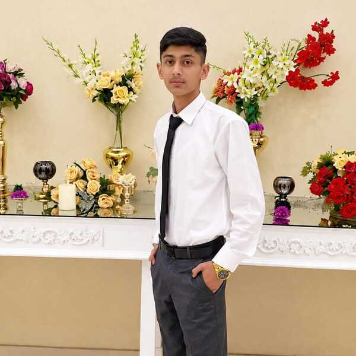

# Samiullah Zulfqar — Web & Mobile App Developer Portfolio

A modern, high-performance, and animated portfolio website for **Samiullah Zulfqar**, a Full-Stack Web and Cross-Platform Mobile App Developer.



## 🌟 Highlights & Features

- **High-Tech Aesthetic**: Deep midnight dark theme with glowing neon gradients, glassmorphism cards (`backdrop-filter: blur`), and a clean Light Mode switch.
- **Interactive Animations**:
  - **Dynamic Particle Mesh**: Interactive canvas constellation reacting to cursor movements.
  - **Typewriter Effect**: Cycling headline titles showcasing mobile and web development roles.
  - **3D Card Perspective Tilt**: Realistic physics-based tilt on hover for project, service, and portrait cards.
  - **Scroll-Triggered Reveals**: Smooth Intersection Observer animations (`fade-up`, `fade-left`, `fade-right`).
  - **Animated Metric Counters**: Numerical stat counters that count up on scroll.
  - **Scroll Progress Indicator**: Top bar indicating reading depth.
  - **Floating Badges**: Floating stat chips with smooth CSS floating keyframes around hero portrait.
- **Interactive Developer CLI Terminal**:
  - Embedded developer terminal with interactive commands (`help`, `skills`, `projects`, `experience`, `contact`, `clear`, `date`).
- **Comprehensive Sections**:
  - **Hero Section**: High-impact introduction featuring Samiullah's portrait, status indicator, action buttons, and social profiles.
  - **Stats Bar**: Key accomplishments (25+ projects, 15+ happy clients, 3+ years experience, 99.8% quality).
  - **About Me**: Professional narrative, personal specs, and core competencies.
  - **Services**: 6 specialized solutions (Cross-platform mobile apps, Full-stack web, Backend APIs, UI/UX to code, Database design, App Store deployment).
  - **Skills & Tech Stack**: Filterable interactive cards with proficiency bars (Flutter, React Native, React, Next.js 14, TypeScript, Node.js, Firebase, PostgreSQL, MongoDB, etc.).
  - **Showcase Projects**: Filterable portfolio projects (FinPulse, DevFlow, FoodExpress, Aura 3D, HealthSync, TaskMaster Pro) with quick-view modal dialogs.
  - **Experience & Education Timeline**: Interactive vertical milestone timeline.
  - **Client Testimonials**: Verified client reviews and feedback.
  - **Contact Section**: One-click copy email button, WhatsApp direct chat link, and interactive contact form with validation and toast notifications.
  - **Resume / CV Modal**: Full printable and downloadable resume viewer.
  - **Audio Effects**: Optional synthesizer sound effects powered by the Web Audio API.

---

## 🛠 Tech Stack

- **HTML5**: Semantic, accessible markup.
- **CSS3**: Custom design tokens, CSS Grid & Flexbox, Keyframe Animations, Glassmorphism.
- **JavaScript (ES6+)**: Zero external bundle dependencies for maximum speed and instant loading.
- **Canvas API**: Custom particle constellation algorithm.
- **Web Audio API**: Synthesized micro-interaction audio feedback.

---

## 🚀 Getting Started

Simply open `index.html` in any modern web browser or serve it with any local static HTTP server:

```bash
# Using Python
python3 -m http.server 3000

# Using Node.js npx
npx serve .
```

Visit `http://localhost:3000` to view the website.

---

## 📬 Contact Information

- **Name**: Samiullah Zulfqar
- **Role**: Web & Mobile App Developer
- **Email**: [samiullahzulfqar980@gmail.com](mailto:samiullahzulfqar980@gmail.com)
- **GitHub**: [github.com/samiullahzulfqar980-cmd](https://github.com/samiullahzulfqar980-cmd)
- **Location**: Islamabad, Pakistan
